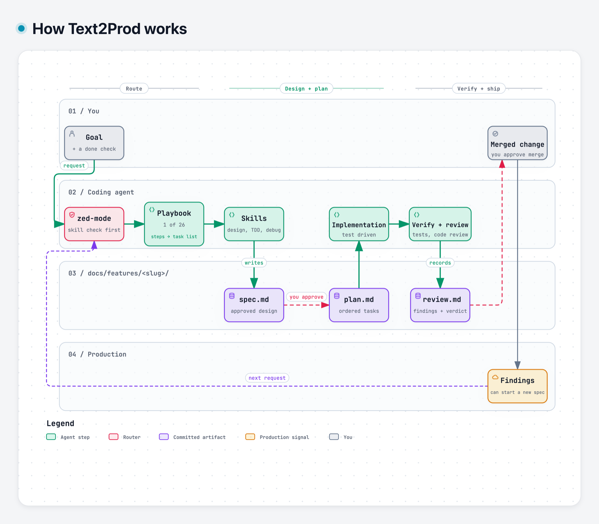

# Text2Prod

Text2Prod has no runtime dependencies and installs into Claude Code, Codex, and OpenCode. It gives a coding agent 19 product skills, the `zed-mode` router, and a delivery workflow that leaves evidence in your repository.

[Get started](docs/get-started.md) · [Visual guide](https://phuongddx.github.io/text2prod/) · [Architecture](ARCHITECTURE.md)

Text2Prod implements the [AI-native SDLC](https://claude.com/blog/the-ai-native-sdlc-playbook). The agent writes the design, plan, implementation, and review record. You approve the decisions that matter.

## How it works

<picture>
  <source media="(prefers-color-scheme: dark)" srcset="assets/how-it-works-dark.png">
  
</picture>

The loop has four stages.

1. Your request reaches `zed-mode`. It checks for a matching skill before it responds.
2. The playbook copies its steps into the agent's task list. Each step names the skill that owns it.
3. Implementation is test driven. The agent must show test output or another direct check before it says a task is done.
4. Feature-sized work writes durable artifacts in `docs/features/<slug>/`. You approve the written spec before planning starts and the merge at the end. `review.md` records the code review findings and verdict. Smaller bounded changes skip `plan.md` and go straight to test-driven implementation. Production findings can start a new spec.

The bootstrap reaches the agent differently in each application.

| Application | How `zed-mode` loads |
| --- | --- |
| Claude Code | `hooks/hooks.json` injects it on session start, `/clear`, and compaction. |
| OpenCode | The plugin injects it through a context hook on each model call. |
| Codex | Codex discovers the skills natively, and the agent loads `zed-mode` by its description. |

## Install

Install Text2Prod separately in each coding agent you use.

### Claude Code

Run these commands in Claude Code:

```text
/plugin marketplace add phuongddx/text2prod
/plugin install text2prod@text2prod
```

Start a new session so the session-start hook runs.

### Codex CLI

Add this repository as a Git marketplace, then install the plugin:

```bash
codex plugin marketplace add https://github.com/phuongddx/text2prod.git
codex plugin add text2prod@text2prod
```

You can also open `/plugins`, search for `text2prod`, and select `Install Plugin`.

### Codex App

Build an archive with `scripts/package-codex-plugin.sh`, then upload it through the Codex portal. The script needs a prior official package as its metadata seed.

### OpenCode

Text2Prod supports OpenCode V2:

```bash
opencode plugin add github:phuongddx/text2prod
```

Or add the plugin to the `plugins` array:

```jsonc
{
  "plugins": ["github:phuongddx/text2prod"]
}
```

See the [OpenCode guide](docs/README.opencode.md) for details.

### Update

Claude Code:

```bash
claude plugin marketplace update text2prod
claude plugin update text2prod@text2prod
```

Codex CLI:

```bash
codex plugin marketplace upgrade text2prod
```

OpenCode:

```bash
opencode plugin update
```

A new release arrives only when the plugin version changes.

## When to use it

Name a playbook when its steps matter. Give the agent a goal, the first check to run, and a done condition that can fail.

| Situation | Prompt to copy |
| --- | --- |
| A reported bug | `Use the bug-fix playbook. The CSV export drops the last row after the Tuesday deploy. Reproduce it first. Done means the 60,000-row fixture exports every row.` |
| A new feature | `Let's add a dark mode toggle. Show me a design before you edit code. Done means the toggle follows the system theme and the existing tests still pass.` |
| A structural cleanup | `Use the refactoring playbook. Split invoice parsing into one module without changing output. Pin behavior with an equivalence check first.` |
| A diagnosis | `Use the investigation playbook. Read the incident thread and identify the root cause. Do not edit code yet.` |

The [getting-started guide](docs/get-started.md) walks through a first feature, the files Text2Prod writes, and the prompts for every workflow.

## A real case

The public [Text2Prod guide](https://phuongddx.github.io/text2prod/) came from a feature in this repository. Its artifact chain is committed with the code.

| Artifact | What it records |
| --- | --- |
| [spec.md](docs/features/guide-site/spec.md) | The reader problem, goals, constraints, and non-goals. |
| [plan.md](docs/features/guide-site/plan.md) | The ordered implementation tasks and verification steps. |
| [review.md](docs/features/guide-site/review.md) | Review findings, decisions, evidence, and the final verdict. |

The spec is marked `Status: shipped`. The review records the issues found and fixed before the guide deployed. The same chain works for application features, infrastructure changes, migrations, and skill edits.

## What you get

| Part | Count | Purpose |
| --- | ---: | --- |
| Product skills | 19 | Written procedures for design, planning, TDD, debugging, delegation, review, and delivery. |
| Router | 1 | `zed-mode` checks for a matching skill before the agent responds. |
| Playbooks | 26 | Step lists for work such as bug fixes, refactors, investigations, shipping, and long autonomous runs. |
| Principles | 24 | The 24 principles are named rules that redirect design, debugging, delegation, and verification decisions. |

Feature-sized work writes one folder:

```text
docs/features/<feature>/
├── spec.md     the approved design
├── plan.md     ordered tasks and checks
└── review.md   findings, decisions, and evidence
```

The durable layout and repository rules are documented in [ARCHITECTURE.md](ARCHITECTURE.md). The full artifact contract is in [docs/feature-workflow.md](docs/feature-workflow.md).

## Development

This repository has no runtime dependencies. `package.json` contains metadata and the OpenCode plugin entry point.

Useful local checks include:

```bash
scripts/lint-shell.sh
tests/claude-code/run-skill-tests.sh
tests/feature-artifacts/run-all.sh
tests/codex/test-marketplace-manifest.sh
scripts/check-guide-site.sh
```

Run the suite that covers the files you changed. [docs/testing.md](docs/testing.md) lists the plugin tests and the separate real-agent evaluation setup.

See [CONTRIBUTING.md](CONTRIBUTING.md) before opening a pull request. Pull requests target `main`, keep the plugin dependency free, and solve one experienced problem.

## Owner and license

Text2Prod is maintained by [PhuongDoan](https://github.com/phuongddx).

The optional brainstorming companion renders its branding as local text. The repository tests reject remote brand assets.

This project uses the [MIT License](LICENSE).
